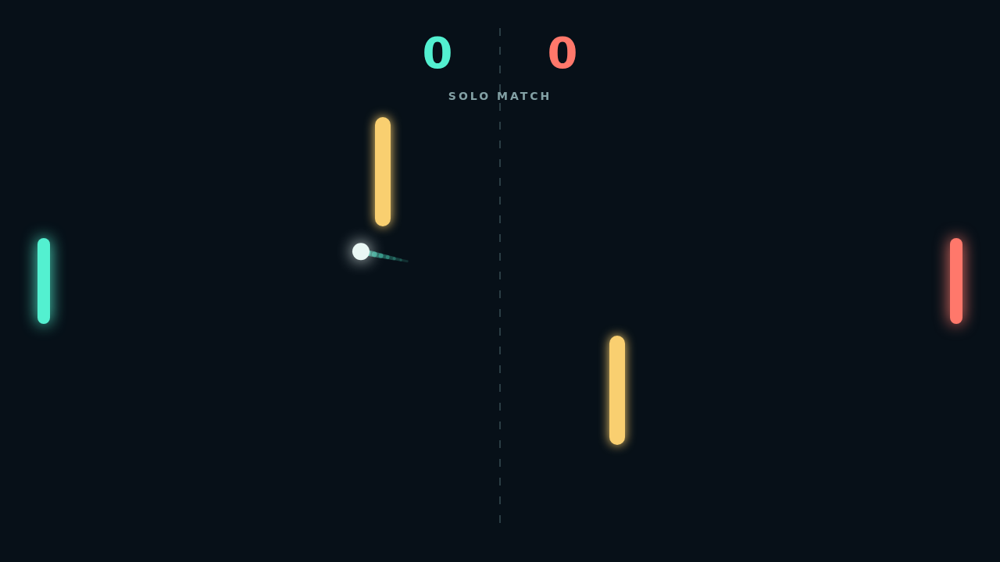

# Carom

Two paddles face off across a midnight field, with a bright ball and a pair of gold obstacles between them. Start a solo match against the quick-reading AI or bring a friend to the same keyboard for local versus play.

Every hit is a chance to shape the rally. Move with the ball as it reaches your paddle to add spin, sending its path curling toward the wall or around an obstacle. A clean straight return is safe; a well-timed bank shot can open the whole court.

Points come fast, but match point takes nerve: reach eleven and keep a two point lead. Each serve resets the angle, while the obstacles make every rally a new route to find.

